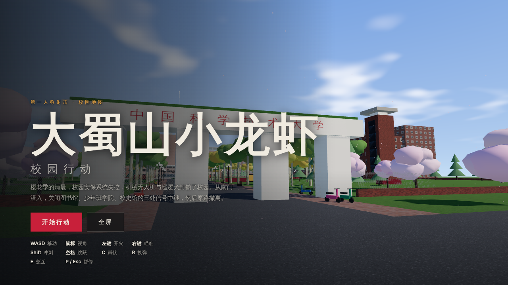
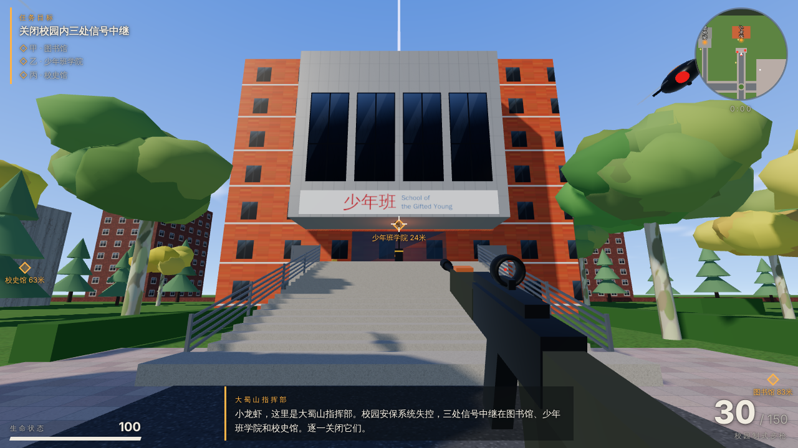

# 大蜀山小龙虾 · 校园行动

单文件 HTML 第一人称射击游戏（three.js），地图为校园：南门、图书馆、红砖教学楼、少年班学院、校史馆。

- 直接用浏览器打开 `index.html` 即可游玩（无需联网、无需服务器）。
- 目标：从南门潜入，关闭图书馆、少年班学院、校史馆的三处信号中继，然后回到南门撤离。
- 操作：WASD 移动 · 鼠标视角 · 左键开火 · 右键瞄准 · Shift 冲刺 · 空格跳跃 · C 蹲伏 · R 换弹 · 按住 E 交互 · P/Esc 暂停；手机支持触屏摇杆与按钮。

## 开发

```bash
npm install
npm run build   # 将 src/ 打包并内联为 index.html
```

源码：`src/world.js`（场景与建筑）、`src/game.js`（玩法、敌人、HUD）、`src/index.html`（页面与样式）。



